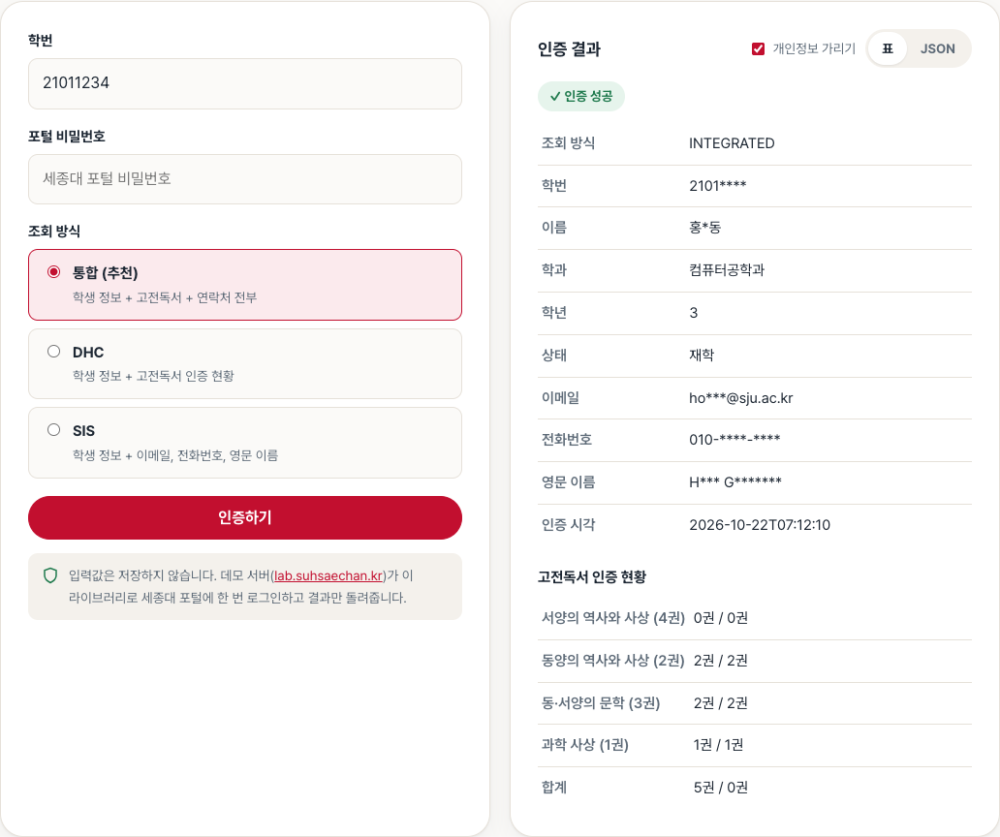

<div align="center">


# SUH Sejong Univ Auth

**세종대학교 포털 인증을 3줄로 끝내는 Spring Boot용 Java 라이브러리**

[English](README.md) | 한국어

[](https://nexus.suhsaechan.kr/#browse/browse:maven-releases:kr%2Fsuhsaechan%2Fsejong-univ-auth)
[](https://openjdk.org/)
[](https://spring.io/projects/spring-boot)
[](LICENSE)

### [▶ 브라우저에서 바로 체험하기](https://cassiiopeia.github.io/SUH-sejong-univ-auth/#demo)

</div>

---

학번과 비밀번호만으로 세종대 재학생 여부, 학과, 학년, 고전독서 인증, 연락처를 가져옵니다.
포털 로그인, SSO 리다이렉트, 세션 쿠키, HTML·JSON 파싱은 라이브러리가 처리합니다.

```java
SejongAuthResult result = sejongAuthEngine.authenticate("학번", "비밀번호");
result.getName();    // "홍길동"
result.getMajor();   // "컴퓨터공학과"
```

<p align="center">
  <a href="https://cassiiopeia.github.io/SUH-sejong-univ-auth/#demo">
    
  </a>
  <br>
  <sub>소개 페이지의 실시간 데모. 실제 인증 결과이며 개인정보 칸만 예시값으로 바꿨습니다.</sub>
</p>

## 왜 이 라이브러리인가

| 직접 구현하면 | 이 라이브러리 |
|---|---|
| 포털 로그인 폼과 SSO 리다이렉트를 직접 분석 | `authenticate()`가 로그인과 SSO 과정을 처리 |
| 세종대 도메인 3곳의 세션 쿠키를 직접 관리 | 호출마다 쿠키 관리, 따로 저장할 것 없음 |
| HTML 표(DHC)와 JSON API(SIS)를 직접 파싱 | 타입이 있는 결과 객체(`SejongAuthResult`) |
| 200 응답 속에서 비밀번호 오류를 직접 판별 | `AUTHENTICATION_FAILED`로 즉시 실패 |
| 포털 TLS·주소가 바뀔 때마다 다시 수정 | 여기서 유지보수, 실제 포털로 검증 |

## 목차

- [왜 이 라이브러리인가](#왜-이-라이브러리인가)
- [이런 곳에 씁니다](#이런-곳에-씁니다)
- [빠른 시작](#빠른-시작)
- [사용법](#사용법)
- [결과 필드](#결과-필드)
- [에러 코드](#에러-코드)
- [설정](#설정)
- [FAQ](#faq)
- [기여하기](#기여하기)

## 이런 곳에 씁니다

- 동아리·학생회·학내 커뮤니티 가입 시 **세종대 학생 인증**
- 학과·학년 조건이 있는 학내 이벤트 참여 확인
- 고전독서 인증 현황을 보여 주는 학습 도우미

| 데이터 소스 | 도메인 | 제공 정보 |
|---|---|---|
| **DHC** (대양휴머니티칼리지) | classic.sejong.ac.kr | 학생 정보 + 고전독서 인증 현황 |
| **SIS** (학사정보시스템) | sjpt.sejong.ac.kr | 학생 정보 + 이메일, 전화번호, 영문 이름 |

## 빠른 시작

> Maven Central이 아니라 **SUH Nexus 저장소**에서 배포합니다. 저장소를 먼저 추가하세요.

**1. 저장소 추가**

```groovy
// build.gradle
repositories {
    mavenCentral()
    maven { url "https://nexus.suhsaechan.kr/repository/maven-releases/" }
}
```

<details>
<summary>Maven</summary>

```xml
<repositories>
    <repository>
        <id>suh-nexus</id>
        <url>https://nexus.suhsaechan.kr/repository/maven-releases/</url>
    </repository>
</repositories>

<dependency>
    <groupId>kr.suhsaechan</groupId>
    <artifactId>sejong-univ-auth</artifactId>
    <version>1.2.12</version>
</dependency>
```

</details>

**2. 의존성 추가** (최신 버전은 위 Nexus 배지 확인)

```groovy
dependencies {
    implementation "kr.suhsaechan:sejong-univ-auth:1.2.12"
}
```

**3. 주입받아 호출**

Spring Boot Auto Configuration이 `SuhSejongAuthEngine` 빈을 등록합니다. 별도 설정은 필요 없습니다.

```java
@RestController
@RequiredArgsConstructor
public class AuthController {

    private final SuhSejongAuthEngine sejongAuthEngine;

    @PostMapping("/auth/sejong")
    public SejongAuthResult authenticate(@RequestParam String studentId,
                                         @RequestParam String password) {
        return sejongAuthEngine.authenticate(studentId, password);
    }
}
```

## 사용법

필요한 정보에 맞는 메서드를 고릅니다. 통합 인증은 SIS(연락처) 조회가 실패해도 학생 정보는 돌려줍니다.

| 메서드 | 용도 | 반환 |
|---|---|---|
| `authenticate(studentId, password)` | 통합: 학생 정보 + 고전독서 + 연락처 | `SejongAuthResult` |
| `authenticateWithDHC(studentId, password)` | 학생 정보 + 고전독서 (보장) | `SejongDhcAuthResult` |
| `authenticateWithSIS(studentId, password)` | 학생 정보 + 연락처 (보장) | `SejongSisAuthResult` |
| `authenticateWithDHCRaw(studentId, password)` | DHC + 원본 HTML (디버깅) | `SejongDhcAuthResult` |
| `authenticateWithSISRaw(studentId, password)` | SIS + 원본 JSON (디버깅) | `SejongSisAuthResult` |

**고전독서 인증 확인**

```java
SejongDhcAuthResult result = sejongAuthEngine.authenticateWithDHC(studentId, password);

for (ClassicCertification certification : result.getClassicReading().getCertifications()) {
    System.out.println(certification.getArea() + " "
        + certification.getCertifiedCount() + "/" + certification.getRequiredCount());
}
```

**실패 처리**: 인증에 실패하면 `SejongAuthException`을 던집니다.

```java
try {
    sejongAuthEngine.authenticate(studentId, password);
} catch (SejongAuthException exception) {
    switch (exception.getErrorCode()) {
        case AUTHENTICATION_FAILED -> // 학번·비밀번호 불일치
        case CONNECTION_FAILED, CONNECTION_TIMEOUT -> // 포털 장애
        default -> // 파싱·세션 오류
    }
}
```

## 결과 필드

통합 인증 결과 `SejongAuthResult` 기준입니다.

| 필드 | 타입 | 설명 |
|---|---|---|
| `success` | boolean | 인증 성공 여부 |
| `studentId` | String | 학번 |
| `name` | String | 이름 |
| `major` | String | 학과(전공) |
| `grade` | String | 학년 |
| `status` | String | 학적 상태 (재학, 휴학, 졸업) |
| `classicReading` | SejongClassicReading | 고전독서 인증 현황, 시험·대회·대체 이수 기록 |
| `email` | String | 이메일 (SIS 실패 시 null) |
| `phoneNumber` | String | 전화번호, `010-1234-5678` 형식 (SIS 실패 시 null) |
| `englishName` | String | 영문 이름 (SIS 실패 시 null) |
| `authenticatedAt` | LocalDateTime | 인증 시각 |

- `SejongDhcAuthResult`: 연락처 필드 없음, Raw 메서드 사용 시 `rawHtml` 포함
- `SejongSisAuthResult`: 고전독서 필드 없음, `grade`·`status`는 빈 문자열, Raw 메서드 사용 시 `rawJson` 포함

## 에러 코드

| 코드 | 의미 |
|---|---|
| `AUTHENTICATION_FAILED` | 학번 또는 비밀번호가 일치하지 않음 |
| `INVALID_INPUT` | 입력값이 비었거나 형식이 맞지 않음 |
| `CONNECTION_FAILED` | 세종대 포털에 연결할 수 없음 |
| `CONNECTION_TIMEOUT` | 포털 응답 시간 초과 |
| `DATA_FETCH_FAILED` | 학생 정보 조회 실패 |
| `PARSE_ERROR` | 포털 응답 구조 변경 등으로 파싱 실패 |
| `SESSION_ERROR` | 포털 세션 처리 오류 |
| `SSL_CONFIGURATION_ERROR` | SSL 설정 오류 |

## 설정

`application.yml`에서 바꿀 수 있습니다. 모두 선택 항목입니다.

```yaml
sejong:
  auth:
    ssl-verification: true   # 포털 인증서 검증 (기본 true)
    timeout-seconds: 10      # 요청 제한 시간 (기본 10)
    max-retry: 3             # 재시도 횟수 (기본 3)
```

요구 사항: **Java 17+**, **Spring Boot 3.x**

> **TLS 안내**: 세종 포털은 최신 JDK가 막아 둔 레거시 cipher(`TLS_RSA_WITH_AES_256_CBC_SHA`)만 제공합니다. 라이브러리는 처음 쓸 때 `jdk.tls.disabledAlgorithms`에서 `TLS_RSA_*`를 빼는데, 이 설정은 이 라이브러리만이 아니라 **JVM 전체**에 적용됩니다. 서비스에서 이를 허용할 수 없다면 인증을 별도 프로세스로 분리하세요.

내부 동작이 궁금하면 [DHC 로그인 플로우](docs/DHC_LOGIN_FLOW.ko.md), [SIS 로그인 플로우](docs/SIS_LOGIN_FLOW.ko.md)를 보세요.

## FAQ

<details>
<summary><b>비밀번호를 저장하나요?</b></summary>

라이브러리는 비밀번호를 저장하지 않고 포털 로그인 요청에만 씁니다. 소개 페이지의 데모 서버도 결과만 돌려주고 입력값을 저장하지 않습니다.
여러분의 서비스에서도 비밀번호를 로그나 DB에 남기지 않도록 주의하세요.
</details>

<details>
<summary><b>세종대학교 공식 라이브러리인가요?</b></summary>

아닙니다. 세종대 학생이 만든 개인 오픈소스이며 학교와 제휴 관계가 없습니다.
</details>

<details>
<summary><b>인증이 갑자기 실패해요</b></summary>

[데모](https://cassiiopeia.github.io/SUH-sejong-univ-auth/#demo)로 먼저 확인해 보세요. 데모도 실패하면 포털 쪽이 바뀌었을 가능성이 높습니다.
[이슈](https://github.com/Cassiiopeia/SUH-sejong-univ-auth/issues)에 에러 코드와 함께 남겨 주세요.
</details>

## 기여하기

버그 제보, 포털 변경 대응, 문서 개선 모두 환영합니다. 빌드·테스트 방법은 [CONTRIBUTING.ko.md](CONTRIBUTING.ko.md)를 보세요.
보안 문제는 [SECURITY.md](SECURITY.md)의 비공개 신고를 이용해 주세요.

## 라이선스

[MIT](LICENSE) © 2025 Suh Saechan

---

<sub>이 프로젝트는 세종대학교의 공식 제품이 아니며 세종대학교와 제휴 관계가 없습니다. 세종대학교 교표의 권리는 세종대학교에 있습니다.</sub>
