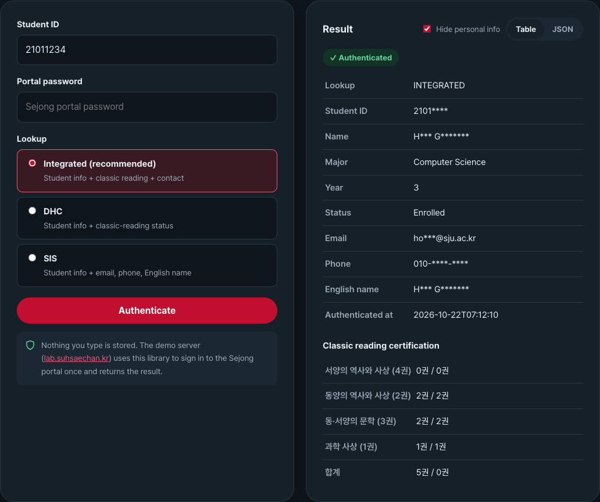

<div align="center">


# pro-sejong-auth

**Sejong University login API for Java, Python and Node.js: verify students in one call**

<sub>세종대 로그인 API · 세종대학교 포털 인증 · 학번 인증 라이브러리 (Java · Python · Node)</sub>

English | [한국어](README.ko.md)

<!-- AUTO-VERSION-SECTION: DO NOT EDIT MANUALLY -->
## Latest Version : v1.2.17 (2026-10-22)

[](https://central.sonatype.com/artifact/kr.suhsaechan/sejong-univ-auth)
[](https://pypi.org/project/pro-sejong-auth/)
[](https://www.npmjs.com/package/pro-sejong-auth)
[](LICENSE)

### [▶ Try it live in your browser](https://cassiiopeia.github.io/pro-sejong-auth/#demo)

</div>

---

Verify a Sejong University student with just a student ID and password, and get their major, year,
classic-reading certification and contact info. The library handles the portal login, SSO redirects,
session cookies, legacy TLS and HTML/JSON parsing. Same features, same results in every language.

| Java / Spring Boot | Python | Node.js |
|---|---|---|
| `implementation "kr.suhsaechan:sejong-univ-auth:<version>"` | `pip install pro-sejong-auth` | `npm install pro-sejong-auth` |

<p align="center">
  <a href="https://cassiiopeia.github.io/pro-sejong-auth/#demo">
    
  </a>
  <br>
  <sub>Live demo on the project page. A real authentication result with personal fields replaced by sample values.</sub>
</p>

## Why this library

| Doing it yourself | With this library |
|---|---|
| Reverse-engineer the portal login form and SSO redirects | `authenticate()` handles the login and SSO chain |
| Keep session cookies across three Sejong domains | Cookies managed per call, nothing to store |
| Get past the portal's legacy TLS cipher and firewall | Handled per language (see [spec/PORTAL_FLOW.md](spec/PORTAL_FLOW.md)) |
| Parse HTML tables (DHC) and a JSON API (SIS) | Typed results |
| Read the portal's verdict from a 200 response (wrong password, locked account) | Fails fast with `AUTHENTICATION_FAILED` / `ACCOUNT_LOCKED` |
| Fix it again when the portal changes | Maintained here, all three languages verified against the live portal |

## Contents

- [Use cases](#use-cases)
- [Quick start: Java / Spring Boot](#quick-start-java--spring-boot)
- [Quick start: Python](#quick-start-python)
- [Quick start: Node.js](#quick-start-nodejs)
- [Operations](#operations)
- [Result fields](#result-fields)
- [Error codes](#error-codes)
- [Configuration](#configuration)
- [FAQ](#faq)
- [Contributing](#contributing)

## Use cases

- **Verifying Sejong students** when they join a club, student council or campus community
- Checking major or year for campus events
- Study helpers that show classic-reading certification progress

| Source | Domain | Data |
|---|---|---|
| **DHC** (Daeyang Humanity College) | classic.sejong.ac.kr | Student info + classic-reading certification |
| **SIS** (Student Information System) | sjpt.sejong.ac.kr | Student info + email, phone, English name |

## Quick start: Java / Spring Boot

Published to **Maven Central** (no extra repository needed). Java 17+, Spring Boot 3.x.

```groovy
dependencies {
    implementation "kr.suhsaechan:sejong-univ-auth:<version>"   // see the Maven Central badge
}
```

<details>
<summary>Maven</summary>

```xml
<dependency>
    <groupId>kr.suhsaechan</groupId>
    <artifactId>sejong-univ-auth</artifactId>
    <version><!-- see the Maven Central badge --></version>
</dependency>
```

</details>

Spring Boot auto-configuration registers a `SuhSejongAuthEngine` bean.

```java
@RestController
@RequiredArgsConstructor
public class AuthController {

    private final SuhSejongAuthEngine sejongAuthEngine;

    @PostMapping("/auth/sejong")
    public SejongAuthResult authenticate(@RequestParam String studentId,
                                         @RequestParam String password) {
        return sejongAuthEngine.authenticate(studentId, password);
    }
}
```

## Quick start: Python

Python 3.9+, no dependencies beyond the standard library.

```bash
pip install pro-sejong-auth
```

```python
from sejong_auth import authenticate, SejongAuthError, ErrorCode

try:
    result = authenticate("21011234", "password")
    print(result.name, result.major, result.grade)
except SejongAuthError as error:
    if error.code == ErrorCode.AUTHENTICATION_FAILED:
        print("Wrong student ID or password")
```

## Quick start: Node.js

Node 18+, zero dependencies, TypeScript types, ESM and CommonJS. Server-side only.

```bash
npm install pro-sejong-auth
```

```js
import { authenticate, SejongAuthError, ErrorCode } from 'pro-sejong-auth';

try {
  const result = await authenticate('21011234', 'password');
  console.log(result.name, result.major, result.grade);
} catch (error) {
  if (error instanceof SejongAuthError && error.code === ErrorCode.AUTHENTICATION_FAILED) {
    console.log('Wrong student ID or password');
  }
}
```

## Operations

| Operation | Java | Python | Node |
|---|---|---|---|
| Integrated: student info + classic reading + contact | `authenticate(id, pw)` | `authenticate(id, pw)` | `authenticate(id, pw)` |
| DHC: student info + classic reading | `authenticateWithDHC` | `authenticate_dhc` | `authenticateDhc` |
| SIS: student info + contact | `authenticateWithSIS` | `authenticate_sis` | `authenticateSis` |
| With raw response (debugging) | `authenticateWithDHCRaw`, `authenticateWithSISRaw` | `include_raw=True` | `{ includeRaw: true }` |

The integrated call still returns student info when the SIS (contact) lookup fails; contact fields are then null.

**Check classic reading (Java)**

```java
SejongDhcAuthResult result = sejongAuthEngine.authenticateWithDHC(studentId, password);

for (ClassicCertification certification : result.getClassicReading().getCertifications()) {
    System.out.println(certification.getArea() + " "
        + certification.getCertifiedCount() + "/" + certification.getRequiredCount());
}
```

## Result fields

Names below are Java / Node. Python uses snake_case (`student_id`, `phone_number`, ...). Full schema: [spec/RESULT_SCHEMA.md](spec/RESULT_SCHEMA.md).

| Field | Type | Description |
|---|---|---|
| `success` | boolean | Whether authentication succeeded |
| `studentId` | string | Student ID |
| `name` | string | Name |
| `major` | string | Major |
| `grade` | string | Year |
| `status` | string | Enrollment status (재학 enrolled, 휴학 on leave, 졸업 graduated) |
| `classicReading` | object | Classic-reading certification, exam, contest and substitution records |
| `email` | string or null | Email (null if SIS fails) |
| `phoneNumber` | string or null | Phone, `010-1234-5678` format (null if SIS fails) |
| `englishName` | string or null | English name (null if SIS fails) |
| `authenticatedAt` | datetime | Authentication time |

- DHC result: no contact fields; `rawHtml` with the raw option
- SIS result: no classic-reading field, `grade` and `status` are empty strings; `rawJson` with the raw option

Text values come from the portal as-is (Korean).

## Error codes

Every language raises one error type with a `code`:

| Code | Meaning |
|---|---|
| `AUTHENTICATION_FAILED` | Student ID or password is wrong |
| `INVALID_INPUT` | Input is empty (checked before any network call) |
| `CONNECTION_FAILED` | Cannot reach the Sejong portal |
| `CONNECTION_TIMEOUT` | Portal timed out |
| `DATA_FETCH_FAILED` | Failed to fetch student info |
| `PARSE_ERROR` | Could not parse the portal response (structure changed?) |
| `SESSION_ERROR` | Portal session error |
| `SSL_CONFIGURATION_ERROR` | SSL configuration error |
| `ACCOUNT_LOCKED` | The portal locked the account after repeated wrong passwords |
| `ACCOUNT_UNAVAILABLE` | The portal account cannot sign in (use period ended or blocked by the administrator) |

Branch on the code, not on the message.

> **Account lock.** The Sejong portal locks an account after repeated wrong passwords (its page says about 5). Unlocking needs a password reset at <https://portal.sejong.ac.kr/jsp/inquiry/pwinquiry.jsp>; no library can do it for the student. The library never retries a rejected login, and stops at the first wrong password without further requests. If your service lets anyone type a student ID, limit failed attempts per student ID so a stranger cannot lock someone else's account.

## Configuration

All optional. Defaults: 10 second timeout, 3 login retries, certificate verification on.

| Java (`application.yml`) | Python | Node |
|---|---|---|
| `sejong.auth.timeout-seconds: 10` | `SejongAuthClient(timeout_seconds=10)` | `new SejongAuthClient({ timeoutSeconds: 10 })` |
| `sejong.auth.max-retry: 3` | `max_retry=3` | `maxRetry: 3` |
| `sejong.auth.ssl-verification: true` | `ssl_verification=True` | `sslVerification: true` |

> **Java TLS note**: the Sejong portal only offers the legacy `TLS_RSA_WITH_AES_256_CBC_SHA` cipher, which recent JDKs disable. On first use the Java library removes `TLS_RSA_*` from `jdk.tls.disabledAlgorithms`, which affects **the whole JVM**. If your service cannot accept that, run the authentication in a separate process. Python and Node only change the TLS settings of their own connections.

How the portal flow works: [spec/PORTAL_FLOW.md](spec/PORTAL_FLOW.md), [DHC login flow](docs/DHC_LOGIN_FLOW.md), [SIS login flow](docs/SIS_LOGIN_FLOW.md).

## FAQ

<details>
<summary><b>Is the password stored?</b></summary>

No. The libraries only use it for the portal login request. The demo server behind the project page also returns the result without storing input.
In your own service, never log or persist passwords.
</details>

<details>
<summary><b>Is this an official Sejong University library?</b></summary>

No. It is a personal open-source project by a Sejong student and is not affiliated with the university.
</details>

<details>
<summary><b>Authentication suddenly fails</b></summary>

Try the [demo](https://cassiiopeia.github.io/pro-sejong-auth/#demo) first. If the demo also fails, the portal has probably changed.
Please open an [issue](https://github.com/Cassiiopeia/pro-sejong-auth/issues) with the error code.
</details>

<details>
<summary><b>I used the SUH Nexus repository before</b></summary>

Older Java versions were published to `https://nexus.suhsaechan.kr/repository/maven-releases/`. New versions are on Maven Central (and still mirrored to Nexus for now), so you can drop the extra repository.
</details>

## Contributing

Bug reports, portal-change fixes and docs improvements are all welcome. A portal change is fixed in all three languages in one PR. See [CONTRIBUTING.md](CONTRIBUTING.md).
Report security issues privately as described in [SECURITY.md](SECURITY.md).

## License

[MIT](LICENSE) © 2025 Suh Saechan

---

<sub>This project is not an official product of Sejong University and is not affiliated with it. The Sejong University seal belongs to Sejong University.</sub>
